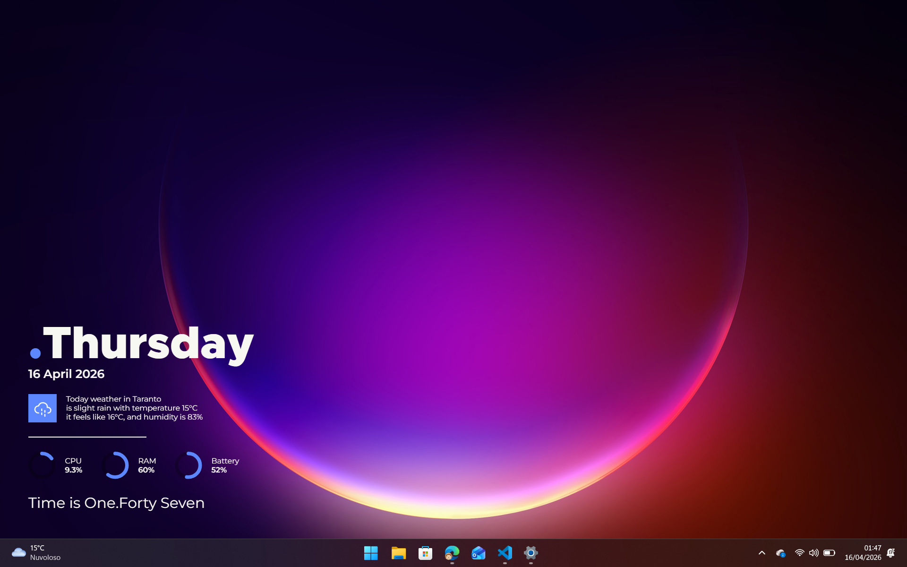

# Antares

A theme for [Vitrine](https://github.com/felixstrobel/vitrine), inspired by [Sargas](https://www.deviantart.com/zren/art/Conky-Sargas-601690886), a Conky theme by zren.



## Features

- **Date** — weekday, day, month, year
- **Time in words** — hour and minutes written out in English (e.g. *Time is Three. Forty-Two*)
- **Weather** — current conditions, temperature, feels-like and humidity, fetched from [Open-Meteo](https://open-meteo.com/) (optional)
- **System gauges** — circular progress rings for CPU, RAM and battery

## Settings

| Setting | Type | Default | Description |
|---|---|---|---|
| `theme` | `dark` \| `light` | `dark` | Color scheme |
| `accentColor` | color | `#448AFF` | Color used for gauge arcs |
| `showWeather` | boolean | `false` | Show weather widget |
| `weatherCity` | string | — | City name for weather lookup |
| `temperatureUnit` | `celsius` \| `fahrenheit` | `celsius` | Temperature unit |
| `showBattery` | boolean | `true` | Show battery gauge |

## Build

```sh
make install   # install dependencies (runs inside Docker, Node 20)
make build     # produce dist/ (runs inside Docker, Node 20)
```

Requires Docker.
